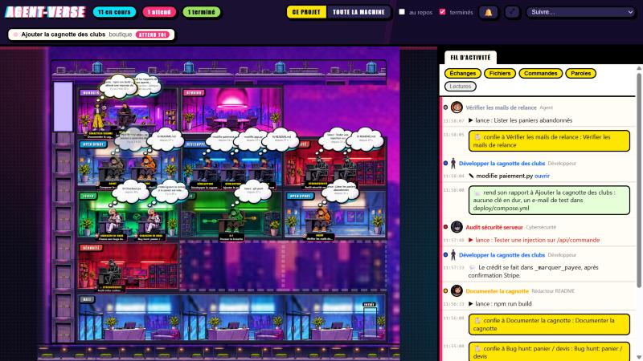

# Agent-Verse



Une extension VS Code pour **voir tes agents Claude Code bosser en direct**, dans une vraie entreprise en style comics : un plan de bureaux (bureau du manager, open space dev, labo sécurité, salle de test, rédaction, salle de réunion), des personnages qui se déplacent et travaillent, les missions et les rapports qui circulent entre eux, et un fil d'activité qui dit qui a fait quoi, à quelle heure.

Tout se passe sur ta machine : l'extension lit les fichiers que Claude Code écrit déjà dans `~/.claude`, et rien n'est envoyé nulle part.

## L'entreprise

- **Les salles** : chaque rôle a la sienne. Le manager (la session principale) est dans son bureau en haut au centre ; les développeurs dans l'open space, la cybersécurité dans son labo, les chasseurs de bugs dans la salle de test, les rédacteurs README dans la rédaction, les autres agents à l'accueil. Au centre, la salle de réunion.
- **Les déplacements racontent l'histoire** : un nouvel agent **entre par la porte**, marche jusqu'au bureau du manager pour **recevoir sa mission** (bulle « GO! », éclat « CALL! »), puis va s'asseoir dans la salle de son rôle. Quand il a fini, il se lève, va **déposer son rapport en salle de réunion** (un document apparaît sur la table, éclat « DONE! »), le manager l'y rejoint, puis il retourne à sa place, grisé avec une pastille verte. S'il **attend une permission ou une réponse de toi**, il se lève et patiente devant le bureau du manager avec « ?! ». Les trajets sont en ligne droite, à vitesse constante.
- **En réunion** : chaque agent a sa chaise autour de la table (six places fixes), sans bulle au-dessus de la tête, juste l'étiquette sous les pieds ; son rapport est un document posé sur la table devant lui (verdict au survol, conversation au clic).
- **Lisibilité** : une seule bulle par personnage, deux lignes au plus, coupée à la fin d'un mot ; survole le personnage pour lire la bulle complète. Les agents terminés gardent leur bulle une trentaine de secondes puis elle s'efface ; décoche « terminés » pour les masquer tout à fait. Les salles vides restent vides.
- **Les communications** : à chaque mission envoyée, un courrier jaune **MISSION** vole du manager vers l'agent ; à chaque rapport rendu, un courrier vert **RAPPORT** revient vers le manager. Un clic sur un personnage (ou sur un courrier) ouvre à droite la **conversation complète** : la mission telle que le manager l'a écrite, puis le rapport tel que l'agent l'a rendu, dans l'ordre, avec « Voir tout » pour le texte intégral.
- **Le fil d'activité** (colonne de droite, ou sous le bureau sur une fenêtre étroite, repliable avec ▾) : les actions consécutives d'un même agent sont regroupées sous son nom (pastille de couleur du rôle et vignette), avec l'heure en gris ; les missions et rapports restent des cartes mises en avant ; les questions posées à l'utilisateur montrent la question, les choix et la réponse. Deux lignes visibles par entrée, clic pour déplier ; clic sur le nom de l'agent pour sa fiche. Des boutons en haut filtrent par type (Échanges, Fichiers, Commandes, Paroles, Lectures).
- **Les sons** (désactivés par défaut) : un petit « ding » quand un rapport est rendu, trois notes quand un agent attend une réponse de toi. La cloche en haut à droite les active ou les coupe (réglage `agentVerse.sounds`).
- **Plusieurs sessions** : un onglet par session Claude sous la barre du haut ; l'entreprise affiche la session choisie (par défaut la plus active).

## L'immeuble modulaire (v0.6, en option)

Le bureau est un **immeuble en coupe** (façon maison de poupée) qui **grandit tout seul** : chaque agent a sa propre place et la garde jusqu'à sa disparition.

- **Pièces** : des modules de 384 × 192 unités (les images fournies font 1536 × 768). Chaque service (Développement, Sécurité, Tests, Rédaction, Git, Open space) a des pièces de 4 places ; le manager a son bureau (1 place) ; la salle de réunion fait deux modules (6 places autour de la table, le manager en bout). Les agents sans rôle reconnu vont en **open space**. Quand un rôle n'a plus de place libre, une **pièce est ajoutée** ; quand l'étage est plein, un **étage** est ajouté. Les places libres montrent un bureau gris (ou `bureau-libre.png`).
- **Disposition** : toit, puis l'étage du haut (manager + réunion), puis les étages de services (3 pièces par étage), le hall au rez-de-chaussée (entrée à droite, côté rue), la rue dessous, une cage d'ascenseur à gauche sur toute la hauteur. Le plan est **ancré en haut** : un nouvel étage s'insère au-dessus du hall, les agents installés ne bougent pas. Un étage dont toutes les pièces sont vides depuis plus de 10 minutes disparaît (seulement l'étage du bas, pour ne rien décaler).
- **Déplacements** : à pied dans l'étage, par l'**ascenseur** entre étages (le personnage entre, les portes se ferment, la cabine monte ou descend, il ressort). Le parcours reste le même : entrée par le hall → brief chez le manager → sa place → rapport en réunion → retour.
- **Caméra** : zoom à la molette, déplacement en cliquant-glissant, bouton ⤢ « tout voir », liste « Suivre… » pour centrer la caméra sur un agent. Pas de mini-carte pour l'instant.
- **Images** : dépose les PNG de la carte dans `C:\Users\ntjum\Downloads\agen vers\map\` (`piece-dev`, `piece-manager`, `piece-securite`, `piece-test`, `piece-redaction`, `piece-git`, `piece-reunion`, `piece-hall`, `piece-openspace`, `ascenseur`, `toit`, `ciel`, `rue`, `bureau-libre`, voir `PROMPTS-MAP.md`), puis `python scripts/preparer-images.py` les copie dans `media/map/`. Tant qu'une image manque, la pièce est un rectangle de la couleur du service avec son nom ; dès qu'elle existe, elle est utilisée.
- **Assets provisoires** (v0.6.1) : `python scripts/decouper-assets.py` découpe la planche `media/sources/map/planche-assets.png` (9 pièces d'environ 350 px, toit, porte d'ascenseur, ciel, rue, et la grille de visages dans `media/visages/`) vers `media/map/`. Ces pièces ont des bureaux dessinés : `media/map/places.json` donne une place par bureau dessiné (fractions de l'image), le personnage assis se pose dessus, et la capacité d'une pièce est son nombre de bureaux (open space dev 3, manager 1, sécurité 2, test 2, rédaction 1, Git 1, débordement 2, réunion 6 chaises). Les visages servent de vignettes dans le fil et sur les étiquettes pour la sécurité, les bugs, la rédaction et les agents génériques. Les vraies images 1536 × 768 copiées depuis `Downloads\agen vers\map\` remplacent ces découpes (adapte alors `places.json`, ou supprime-le pour revenir aux 4 places par pièce).
- Réglage `agentVerse.map` : `decor` (défaut, le grand décor d'une seule image ci-dessous) ou `immeuble`.

## Le décor et les personnages en images (v0.4, par défaut)

Par défaut, le bureau est un **décor peint** (`media/decor-nuit.jpg`, vue de haut la nuit, sept zones) et les agents sont des **images** découpées d'une planche (`media/sprites/<rôle>-<pose>.png`, trois poses : assis au bureau, debout, marche ; le miroir horizontal sert pour marcher vers la gauche). Les cartouches de titres et le texte restent en HTML/CSS par-dessus ; les bulles des personnages utilisent la bulle de pensée découpée (`icones/pensee.png`, traîne vers la tête, en miroir près du bord droit) ; le document sur la table, l'enveloppe des missions et les éclats CALL!/DONE! utilisent les icônes découpées (`media/icones/`). Les personnages assis se posent sur le bureau du décor (leur propre bureau le recouvre).

- **Git et 3D Maker en images** (v0.8) : l'ingénieur Git (veste verte et orange) et la créatrice 3D (hoodie teal et orange, rôle `3d`, reconnu quand le prompt commence par « # Agent 3D Maker (Blender) ») ont leurs propres sprites (`media/sprites/git-*`, `3d-*`) et bandes de marche (`media/anim/`), plus une animation au clavier pour la 3D. Sources dans `media/sources/perso/` et `media/sources/anim/`, découpe par `python scripts/decouper-persos.py` puis `python scripts/preparer-images.py`. Git va en salle de test, 3D en open space (ou en rédaction si l'open space est plein). Éclat « RENDER! » quand l'agent 3D lance Blender.
- **Une place par bureau dessiné** (v0.7) : les sièges de `zones.json` sont relevés sur l'image, un par bureau réellement dessiné (open space dev 3, labo sécurité 2, salle de test 2, rédaction 1, bureau du manager 1, réunion 6 chaises) ; deux agents ne partagent jamais un bureau. Git va en salle de test. Quand la salle d'un rôle est pleine, l'agent **déborde sur une chaise libre de la salle de réunion** (debout), puis le long de ses murs ; jamais devant l'accueil en bas de l'image. Les chaises occupées ainsi ne servent pas aux rapports.
- `media/zones.json` décrit les zones (rectangles), les sièges (un point au sol par bureau), le bureau du manager et ses places de visiteurs, la table de réunion et ses places, l'entrée et les couloirs : un couloir sous les bureaux du haut, le sol libre en bas, et deux passages verticaux entre les salles. Les trajets passent par ces couloirs (entrée → manager → salle du rôle → réunion → retour), sans pathfinding.
- Les **sièges** de `zones.json` sont calés sur les chaises du décor (les pieds du sprite assis sur la chaise, son bureau recouvrant celui du décor). Les agents **sans rôle reconnu** prennent un poste libre de l'open space et leur étiquette affiche le type de sous-agent demandé par Claude (`Explore`, `Plan`, `general-purpose`…).
- **Animations** : dépose des bandes PNG (une ligne de cases carrées de 256×256, fond transparent) dans `C:\Users\ntjum\Downloads\agen vers\animations\` : `<rôle>-marche.png` (12 cases), `<rôle>-clavier.png` (8), en option `<rôle>-attente.png` (6) ; les GIF vont dans `media/sources/anim/<rôle>-<anim>.gif`. Puis `python scripts/preparer-images.py` : il convertit les GIF en bandes, copie les bandes, et mesure tout (taille, tête, pieds) dans `media/sprites.json`. Le bureau joue la bande (CSS `steps`, 100 ms par case) à la place de l'image fixe, et retombe sur l'image fixe si la bande manque. La marche du manager est déjà branchée.
- Le réglage `agentVerse.style` permet de revenir à l'ancien rendu **dessiné** (plan et personnages en SVG) si les images ne chargent pas.
- Pour refaire les sprites à partir d'une nouvelle planche (6 personnages × 3 poses sur 3 lignes, puis 5 icônes) : `python scripts/decouper-planche.py media/sources/planche-1.png` (il faut Pillow et numpy). Le script enlève le halo lumineux, découpe par bandes, rogne au contenu, garde le petit robot avec le rédacteur, et écrit un aperçu de contrôle `media/sprites/contact.png`. Planche retenue : la 1 (personnages cohérents entre poses, pas d'étiquettes). Pour un personnage seul avec ses trois poses sur une ligne (par exemple le manager à ton image, `media/sources/manager-perso.png`) : `python scripts/decouper-planche.py media/sources/manager-perso.png --ligne manager` ; si deux poses se touchent, le script les sépare par une couture verticale passant par les pixels les plus transparents.

## Ce que ça montre pour chaque agent

Pour chaque agent (la session principale = le **manager**, et chaque sous-agent lancé par l'outil `Agent`) :

- **Son rôle**, reconnu automatiquement quand le skill `equipe-dev` est utilisé, avec un personnage original en style comics (dessiné en SVG dans `media/characters.js`, aucun visuel protégé) : Manager à l'image de l'utilisateur en mode images (noir et rouge en mode dessiné), Développeur en rouge et bleu, Cybersécurité en noir et blanc avec imperméable et chapeau, Chasseur de bugs en blanc à capuche rose et turquoise, Rédacteur README en écolière accompagnée d'un petit robot rouge, un cochon-araignée pour les agents sans rôle reconnu, et l'agent Git (vert foncé et orange, en salle de test puisqu'il rejoue la CI, onomatopées « PUSH! » quand il pousse et « CI OK! » quand la CI passe ; en mode images il emprunte le personnage générique teinté en vert en attendant ses propres images). Rendu comics : contours épais, trame de points fine, ombres portées, légère aberration chromatique, et une petite respiration quand l'agent travaille.
- **Ce qu'il fait là, maintenant** : l'outil en cours traduit en français, et depuis combien de temps.
- **Son état**, annoncé par un éclat-étoile qui surgit au-dessus de sa tête quand il change puis disparaît (un personnage sans événement récent n'a aucun éclat) : `TAP TAP` (écrit), `SCAN` (lit / cherche), `VROOM` (lance une commande), `CALL!` (délègue à un sous-agent), `HMM…` (réfléchit), `?!` (attend une réponse ou une permission), `DONE!` (terminé), `ZZZ` (au repos).
- Sa **mission** (ce que le manager lui a demandé), les **fichiers** lus et modifiés (cliquables), la **durée**, le nombre d'actions et les **tokens** consommés.
- Les sous-agents lancés par un sous-agent apparaissent sous lui, en plus petit.

Un clic sur un personnage ouvre sa **fiche détail** à droite. Le bouton **Journal complet** (ou un double-clic) ouvre son journal lisible : tout ce qu'il a dit et fait, mis en forme, qui défile pendant qu'il travaille. **Fichier brut** ouvre la transcription technique.

La **barre d'état** (en bas de VS Code) indique en permanence combien d'agents tournent et si l'un d'eux attend quelque chose de toi.

## Installation

Il te faut Node.js (18 ou plus) et VS Code (1.100 ou plus).

### Option 1 : lancer en mode développement (le plus simple pour essayer)

```bash
npm install
```

```bash
npm run compile
```

Puis ouvre le dossier `agent-verse` dans VS Code et appuie sur **F5**. Une deuxième fenêtre VS Code s'ouvre avec l'extension chargée. Ouvre-y ton projet (par exemple Basket5), puis la commande **Agent-Verse : ouvrir le bureau des agents** (`Ctrl+Maj+P` et tape « Agent-Verse »), ou clique sur « Agents » dans la barre d'état en bas.

### Option 2 : installer pour de bon (fichier `.vsix`)

```bash
npm run package
```

Ça crée un fichier `agent-verse-0.8.0.vsix`. Dans VS Code : `Ctrl+Maj+P` → **Extensions : Install from VSIX…** → choisis ce fichier. L'extension reste installée, même après redémarrage.

**Pour mettre à jour** une version déjà installée : refais `npm run compile` puis `npm run package`, installe le nouveau `.vsix` de la même façon (il remplace l'ancien), puis **Developer: Reload Window** (`Ctrl+Maj+P`) ou redémarre VS Code.

## Utilisation

1. Lance Claude Code comme d'habitude (dans le terminal, dans l'extension VS Code ou dans l'app Claude) et donne-lui une tâche.
2. Ouvre le bureau : commande **Agent-Verse : ouvrir le bureau des agents**. Il se met à jour tout seul (toutes les 1,5 s par défaut).
3. En haut :
   - **Ce projet** : seulement les sessions Claude lancées dans le dossier ouvert dans VS Code (par défaut).
   - **Toute la machine** : toutes les sessions Claude de l'ordinateur, y compris celles de l'app Claude.
   - **sessions au repos** : montre aussi les sessions vivantes qui ne font rien (sinon elles sont cachées pour ne pas encombrer).
   - **terminés** : garde les agents finis à l'écran (pendant 2 h par défaut).
4. Clique sur un personnage pour la fiche détail, double-clique pour le journal.

La commande **Agent-Verse : ouvrir le journal d'un agent** propose directement la liste des agents détectés.

## Réglages

Dans les paramètres VS Code (`Ctrl+,`, cherche « Agent-Verse ») :

| Réglage | Par défaut | À quoi ça sert |
|---|---|---|
| `agentVerse.scope` | `workspace` | `workspace` = le dossier ouvert, `all` = toute la machine |
| `agentVerse.showFinishedMinutes` | `120` | Combien de minutes garder les agents terminés à l'écran |
| `agentVerse.map` | `decor` | `decor` = décor fixe d'une image, `immeuble` = immeuble modulaire |
| `agentVerse.style` | `images` | `images` = décor peint et sprites, `dessine` = rendu SVG de secours |
| `agentVerse.sounds` | `false` | Petits sons (rapport rendu, agent qui attend) |
| `agentVerse.refreshMs` | `1500` | Fréquence de rafraîchissement (en millisecondes) |
| `agentVerse.claudeDir` | *(vide)* | Dossier de données de Claude Code si ce n'est pas `~/.claude` |

## Comment ça marche (pour les curieux)

Claude Code écrit une transcription de chaque session dans `~/.claude/projects/<dossier-du-projet>/<id-session>.jsonl`, une ligne JSON par événement (message, appel d'outil, résultat). Les sous-agents lancés avec l'outil `Agent` ont chacun leur fichier dans `<id-session>/subagents/agent-<id>.jsonl`, avec un petit `agent-<id>.meta.json` qui donne la description de la mission et indique s'il a fini.

L'extension :

- repère les sessions vivantes grâce à `~/.claude/sessions/<pid>.json` (identifiant, dossier, nom, état occupé / au repos) et vérifie que le processus existe encore ;
- lit les transcriptions **de façon incrémentale** : seulement ce qui a été ajouté depuis le dernier passage. Les grosses transcriptions (plusieurs centaines de Mo) ne sont jamais relues en entier, on ne lit que leurs derniers 3 Mo au démarrage ;
- reconnaît le rôle d'un sous-agent au début de son prompt (`# Agent développeur`, `# Agent cybersécurité`, `# Agent chasseur de bugs`, `# Agent rédacteur README`, `# Agent Git`, c'est-à-dire les fiches de `~/.claude/skills/equipe-dev/agents/`) ;
- considère qu'un outil est « en cours » tant que son résultat n'est pas arrivé, et qu'un agent a fini quand il a appelé `SubagentHandback` (rendu son rapport) ou que son fichier meta dit `finished` ;
- reconstitue les communications : la **mission** est le prompt de l'appel `Agent` dans la transcription du lanceur (relié au sous-agent par son `toolUseId`), le **rapport** est le message passé à `SubagentHandback` dans la transcription du sous-agent (ou le résultat de l'outil `Agent` pour un agent lancé en mode synchrone). Un sous-agent qui lance lui-même des sous-agents est reconnu comme leur lanceur.

Aucune connexion réseau, aucun hook ajouté à Claude Code, aucun fichier modifié dans `~/.claude`.

## Tester sans VS Code

Pour voir ce que la détection trouve en ce moment :

```bash
node out/cli.js "C:\chemin\de\ton\projet"
```

Ajoute `--all` pour toute la machine, `--json` pour le détail brut, `--finished=600` pour inclure les agents finis depuis moins de 10 h.

Pour un aperçu du bureau dans un navigateur : `node out/cli.js "C:\chemin\de\ton\projet" --preview`, puis sers le dossier (par exemple `python -m http.server 8765`) et ouvre `http://localhost:8765/scripts/preview.html`. Ajoute `?demo` à l'adresse pour un bureau fictif qui montre tous les états.

## Limites connues

- Les agents apparaissent quand Claude Code a écrit leur première ligne de transcription, en général une seconde ou deux après leur lancement.
- « Attend » est deviné : un outil sans réponse depuis plus de 90 s est considéré comme une permission à accorder ou une question posée. Claude Code n'écrit pas explicitement « j'attends une permission » dans la transcription.
- Une session fermée brutalement reste affichée « sans nouvelles » jusqu'à 10 minutes, puis disparaît.
- Les sessions Claude lancées dans le cloud (claude.ai) n'ont pas de transcription locale et ne sont pas visibles.

## Structure du projet

```
src/
  extension.ts   point d'entrée VS Code : commandes, panneaux, barre d'état
  scanner.ts     découverte des sessions et sous-agents, construction de l'état
  transcript.ts  lecture incrémentale d'un fichier JSONL
  sessions.ts    lecture de ~/.claude/sessions (sessions vivantes)
  roles.ts       reconnaissance des rôles equipe-dev
  describe.ts    traduction des appels d'outils en français
  paths.ts       où Claude Code range ses fichiers
  cli.ts         outil de test en ligne de commande
media/
  office.js/css  le bureau (webview)
  characters.js  personnages SVG (mode « dessiné »)
  building.js    l'immeuble modulaire (pièces, places, étages, ascenseur)
  map/           images de l'immeuble (facultatives)
  zones.json     zones, sièges et couloirs du décor (mode « images »)
  decor-nuit.jpg, sprites/, icones/   décor et images découpées
  sources/       planches et décor d'origine (pas dans le .vsix)
  journal.js/css le journal d'un agent (webview)
scripts/
  preview*.html  aperçus hors VS Code (?style=dessine pour le SVG)
  preparer-images.py   GIF → bandes, copie des bandes, mesures dans media/sprites.json
  decouper-planche.py  découpe une planche en sprites
```
